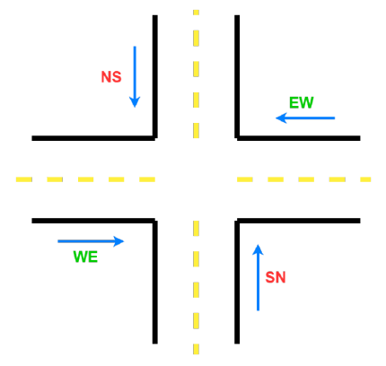
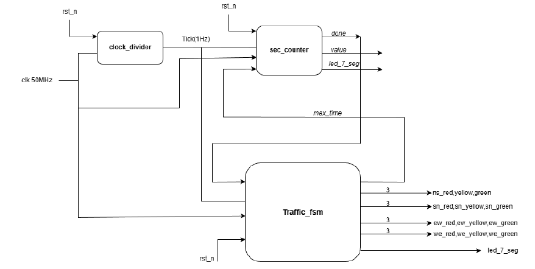
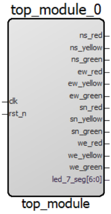
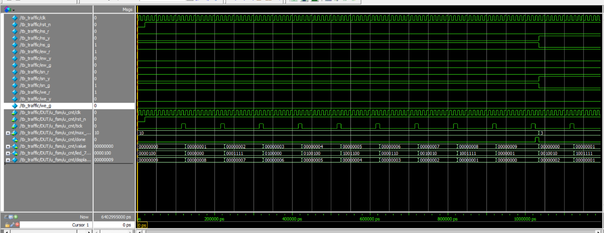
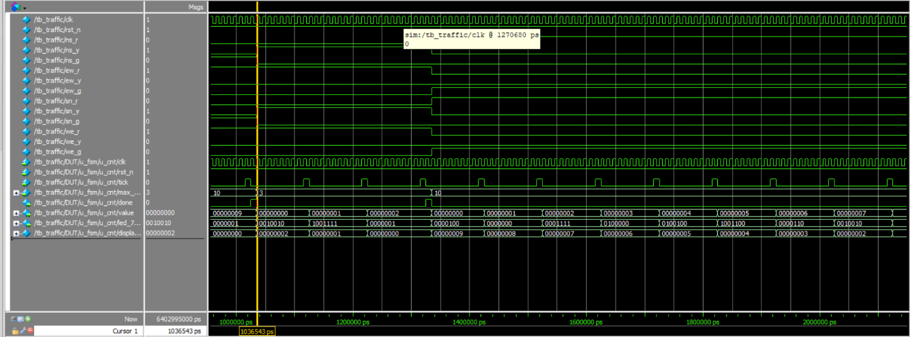
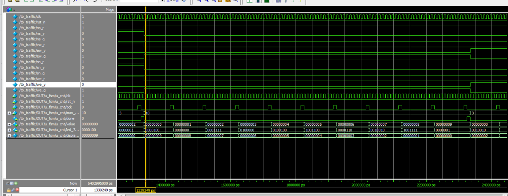
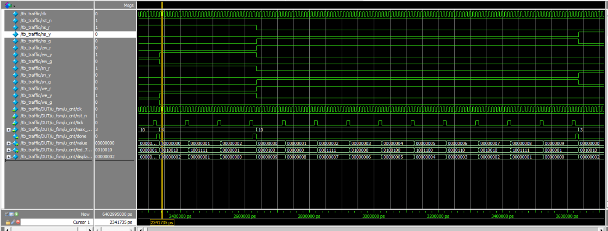

# 4-Way Traffic Light Controller (Verilog, FPGA)

A traffic light controller for a four-way intersection, written in Verilog and implemented on a Microchip PolarFire SoC FPGA (MPFS095T) with Libero SoC 2025.1. The design cycles through green, yellow, and red for each direction and shows the remaining seconds on a 7-segment display.

<p align="center"></p>

## About this project

Individual project for the Digital Engineering course (University of Science and Technology, The University of Da Nang, 12/2025). I designed and implemented it from scratch: architecture, RTL, testbenches, simulation, synthesis in Libero SoC, and programming the board.

## Features

- Four directions controlled: NS, SN (north-south) and EW, WE (east-west)
- Fixed cycle: NS/SN green → NS/SN yellow → EW/WE green → EW/WE yellow
- Countdown shown on one 7-segment digit (common anode): 9 → 0 during green, 2 → 0 during yellow
- Parameterized: clock frequency, green time, and yellow time can be changed without editing the logic
- Active-low reset returns the controller to the first state
- Simulated before and after synthesis in ModelSim, then programmed onto the FPGA board

## Repository structure

```
rtl/
  top_module.v        Top level: connects the divider and the FSM
  clock_divide.v      clk_divider: 50 MHz clock to a 1 Hz tick
  traffic_fsm.v       traffic_fsm: 4-state Moore FSM, instantiates sec_counter
  counter.v           sec_counter: second counter, countdown value, 7-segment decoder
tb/
  testbench_trafic.v  Top-level testbench, module tb_traffic (CLK_FREQ shortened to 10 for simulation)
  tbcouner.v          Testbench for sec_counter, module tb_sec_counter
constraints/
  user.pdc            Pin assignment for the board (Libero I/O constraints)
reports/
  resource_usage.rpt  Synthesis resource usage
docs/images/          Block diagram and simulation waveforms used in this README
```

## Block diagram



| Module | Role |
|---|---|
| `clk_divider` | Counts `DIV` clock cycles (default 50,000,000) and outputs a one-cycle `tick` every second |
| `sec_counter` | Counts ticks from 0 to `max_time − 1`, raises `done` at the end, and drives the 7-segment display with `max_time − value − 1` |
| `traffic_fsm` | Moves to the next state when `done` is high, sets `max_time` for the state, and drives the 12 light outputs |
| `top_module` | Top level that wires everything together |

### Top-level ports



| Port | Dir | Description |
|---|---|---|
| `clk` | in | Board clock, 50 MHz |
| `rst_n` | in | Active-low reset |
| `ns_*`, `sn_*`, `ew_*`, `we_*` (red, yellow, green) | out | 12 light outputs, three per direction |
| `led_7_seg[6:0]` | out | 7-segment display, active low (common anode) |

Parameters: `CLK_FREQ` (default 50,000,000), `GREEN_TIME` (default 10 s), `YELLOW_TIME` (default 3 s).

### FSM states (Moore machine)

| State | NS / SN | EW / WE | Duration |
|---|---|---|---|
| `S_NS_G` | green | red | `GREEN_TIME` |
| `S_NS_Y` | yellow | red | `YELLOW_TIME` |
| `S_EW_G` | red | green | `GREEN_TIME` |
| `S_EW_Y` | red | yellow | `YELLOW_TIME` |

Red time is not a separate parameter: each direction stays red while the other direction is green and yellow (10 s + 3 s with the default values).

## Simulation

Run in ModelSim (the FSM uses `typedef enum`, so compile as SystemVerilog):

```bash
vlog -sv rtl/*.v tb/testbench_trafic.v
vsim tb_traffic
run -all
```

The `tb_traffic` module sets `CLK_FREQ` to 10 so that one "second" lasts only a few clock cycles, and it ends at 2 µs. Both the pre-synthesis and the post-synthesis simulations ran in ModelSim with 0 errors.

**Reset: NS/SN green, EW/WE red (10 s)**


**After 10 s: NS/SN yellow, EW/WE red (3 s)**


**After 3 s: EW/WE green, NS/SN red (10 s)**


**After 10 s: EW/WE yellow, NS/SN red**


## Implementation

| Item | Value |
|---|---|
| Tool | Microchip Libero SoC 2025.1 |
| Device | PolarFire SoC MPFS095T |
| Programming | FlashPro5 over JTAG (chain programming passed) |
| Total LUTs | 143 |
| Flip-flops (SLE) | 62 |
| I/O | 21 (2 inputs, 19 outputs) |
| Global clock buffers | 1 |

Full numbers are in `reports/resource_usage.rpt`.

## Demo and explanation videos

- Code and simulation walkthrough: https://youtu.be/_8N1lpiAuDk
- Hardware demo: https://youtu.be/p-LmVMJvJ5M

## Limitations and ideas for improvement

- Cycle times are fixed, so the controller cannot adapt to traffic.
- The display shows only one digit (0–9). A longer green time needs a second digit.
- There is no emergency mode for priority vehicles.
- `value` and `max_time` in `sec_counter` are 32 bits wide, which is more than the 0–10 second range needs. Narrowing them to 4 bits would remove most of the 91 carry cells in the resource report.
- `traffic_fsm` connects a 6-bit `max_time` to the 32-bit port of `sec_counter`, and ModelSim reports a port-size warning. Making the widths match removes it.
- The testbenches only produce waveforms for visual inspection. Adding self-checking assertions would make the verification repeatable.

## Tools

Verilog, ModelSim, Microchip Libero SoC 2025.1, FlashPro5.
